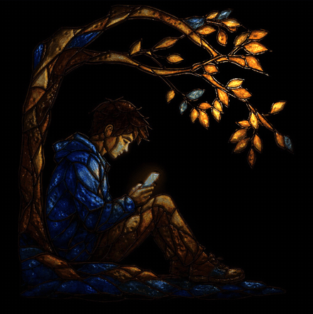
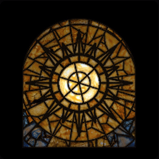
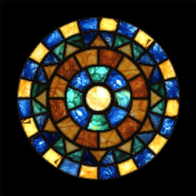
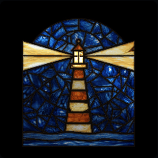

# Stained glass, lit live

Turn a still stained-glass picture into living glass in the browser, and build new stained-glass designs out of real glass. No video model and no image generator: a few small scripts and one WebGL file.



| | | |
|---|---|---|
|  |  |  |

## How it works

1. **Cut the picture into its glass.** Lead lines are darker than the glass beside them, so a local-contrast test finds them, even through dark blue glass. Every region between leads becomes one piece (406 in the window above).
2. **Give each piece depth.** Flat in the middle, rounding down into its lead, like glass seated in a came.
3. **Light it live.** A small WebGL shader lights every piece by its own level as a slow light moves. The edge facing the light catches a glint, lit glass warms and glass in shadow cools, faint ripples spread from the light, and branches can sway. It runs at 60 frames a second in Safari and Chrome.
4. **New designs from real glass.** Geometric designs (sun, moon, compass, lighthouse, rose window) are drawn as shapes, and every pane is filled with a real piece of glass cut from existing art. The texture, colour and darkening into the lead are real, so the designs do not look generated.

What we learned along the way: code is great at light, depth and motion, and poor at drawing people and plants. Light real art; draw only geometry.

## Try it

```bash
cd demo && python3 -m http.server 8000     # then open http://localhost:8000
```

## Use it on your own art

```bash
pip install numpy scipy pillow scikit-image
python stained-glass/scripts/segment.py my_window.jpg --out maps --name window
python stained-glass/scripts/depth.py maps/window_ids.png
```

Then load `stained-glass/engine/glassengine.js` and point it at the maps (see `stained-glass/SKILL.md`).

## As a Claude Code skill

Copy `stained-glass/` into `~/.claude/skills/`. `SKILL.md` tells Claude when to use it, the pipeline, and the shipping rules (Safari, WebGL contexts, caching, reduced motion).

## Credits

Made for [Heard of You](https://heardofyou.io), whose homepage window is lit by this engine. Code under the MIT licence. The window art and the glass bank maps in `demo/` belong to Heard of You; use them to try the demo, not in your own products.
